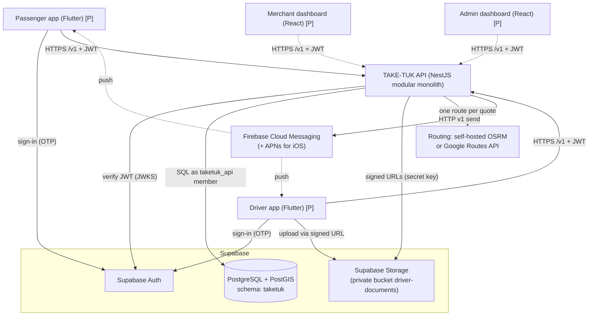
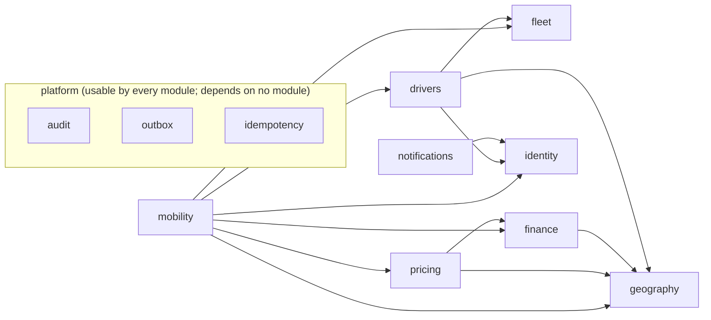

# TAKE-TUK — System architecture

| | |
|---|---|
| Status | Reflects the implemented backend foundation (first ride-booking slice). Planned parts are marked **[P]**. |
| Related | [ADRs](decisions/README.md), [Database design](DATABASE_DESIGN.md), [Domain model](../domain/DOMAIN_MODEL.md), [Security](../security/SECURITY.md), [Operations](../operations/OPERATIONS.md) |

## 1. System context



Clients talk to Supabase directly only for **authentication** and for **uploads to backend-issued signed URLs**. Every business operation goes through the API (ADR-0007).

## 2. Repository layout

```
/
├─ MANIFESTO.md                 engineering constitution
├─ docs/                        product, architecture, domain, API, security, operations
├─ supabase/
│  ├─ config.toml               Supabase CLI local configuration
│  ├─ migrations/               authoritative schema history (SQL)
│  └─ seed.sql                  development-only data (labelled)
├─ backend/                     NestJS API (one deployable)
│  ├─ src/
│  │  ├─ main.ts, app.module.ts
│  │  ├─ config/                validated environment configuration
│  │  ├─ shared/                errors, HTTP plumbing, auth vocabulary, money, pagination, state-machine helper
│  │  ├─ infrastructure/        database pool, transactions, plain-PostgreSQL migration runner
│  │  ├─ platform/              cross-cutting modules: audit, outbox, idempotency, worker base class
│  │  ├─ modules/<module>/      domain/ application/ infrastructure/ http/ index.ts
│  │  └─ cli/                   operator CLI (migrate, seed-dev, grant-role)
│  ├─ test/                     unit, architecture, integration, concurrency, security, failure tests
│  └─ Dockerfile                API image (build context: repository root)
├─ apps/                        [P] passenger_app, driver_app (Flutter); merchant_web, admin_web (React)
└─ packages/                    [P] shared Dart packages and TypeScript API contracts
```

There is no root JavaScript workspace yet, because only one JavaScript project exists. When the React apps arrive, a workspace is introduced for shared TypeScript contracts generated from `openapi.json`. The web apps must not import backend source.

## 3. Backend modules

| Module | Owns (tables) | Responsibilities | Depends on (business modules) |
|---|---|---|---|
| `identity` | `users`, `user_roles` | Token verification, current-user resolution, registration, global access guard | — |
| `geography` | `service_areas`, `service_area_services` | Service-area lookup; `RoutingProvider` port and adapters | — |
| `fleet` | `vehicle_types`, `service_types`, `service_vehicle_compatibility`, `vehicles` | Vehicle catalogue, compatibility rules, vehicle records and their state machine | — |
| `drivers` | `drivers`, `driver_locations`, `driver_documents` | Driver registration, documents (storage port), verification and vehicle review orchestration, availability, location, operational eligibility view | identity, fleet, geography |
| `finance` | `commission_policies`, `ride_payments`, `ledger_transactions`, `ledger_entries` | Commission policies, payment records, ledger postings, earnings | geography |
| `pricing` | `fare_policies`, `fare_quotes` | Fare-policy versions, minimum-fare calculation, negotiation rules, quotes | geography, finance |
| `mobility` | `rides`, `ride_offers`, `fare_agreements`, `ride_assignments` | Ride creation, dispatch and matching, negotiation, atomic assignment, trip lifecycle, cancellation and expiry; dispatch worker | identity, pricing, drivers, fleet, finance, geography |
| `notifications` | `device_registrations` | Device tokens; outbox handlers that turn domain events into pushes; `NotificationProvider` port (FCM, log) | identity |
| `health` | — | Liveness and readiness | — |
| `platform/audit` | `audit_events` | Append audit events inside transactions; admin audit queries | (shared only) |
| `platform/outbox` | `outbox_events` | Enqueue events transactionally; delivery worker; retention worker | (shared only) |
| `platform/idempotency` | `idempotency_keys` | Idempotency-key execution inside the effect's transaction; cleanup worker | (shared only) |

The rules, enforced by `backend/test/architecture/architecture.spec.ts`:

1. A module imports another module only through that module's `index.ts`.
2. The module dependency graph is acyclic and matches the table above.
3. `domain/` folders import nothing from NestJS, `pg`, or infrastructure.
4. SQL `INSERT`, `UPDATE` and `DELETE` statements touch only tables owned by the module containing them.
5. Platform, shared, infrastructure and config code never import business modules.
6. Every HTTP route declares an access rule (checked on the generated OpenAPI document by `test/unit/openapi.spec.ts`, and at runtime by the deny-by-default guard).

Cross-module atomic operations pass a transaction handle to the owning module's public service. For example, `mobility` calls `finance.recordRideCompletion(tx, …)` and `drivers.lockOperationalDriver(tx, …)`. The one documented read-only exception is mobility's dispatch candidate query, which joins driver, fleet and location tables in a single SQL statement (`dispatch-candidates.query.ts`). Domain events that tolerate eventual consistency (notifications) go through the outbox.



## 4. Request lifecycle

1. The `RequestContext` middleware assigns or validates `X-Request-Id` and starts timing.
2. `AccessGuard` (global) reads the route's declared access rule (public, authenticated, or registered with permissions). For non-public routes it verifies the bearer JWT, loads the user and roles from the database, rejects disabled users, then enforces the rule. A route with no declared rule fails closed.
3. `ZodValidationPipe` validates the body, params and query.
4. The controller calls one application use case, which opens a transaction (`Database.transaction`), locks rows, checks preconditions, writes state, audit and outbox, and commits.
5. Post-commit best-effort work runs, such as the first dispatch round after ride creation.
6. `ProblemDetailsFilter` converts errors to RFC 9457 responses. The request log line records method, route, status, duration, request id and user id. It never records bodies or tokens.

## 5. External integrations

| Integration | Port | Adapters | Status |
|---|---|---|---|
| Supabase Auth | `TokenVerifier` | JWKS (ES256/RS256), legacy HS256 secret | Implemented. Tested with locally generated ES256 keys (unit and HTTP tests) and HS256 (compiled-server smoke test). **Not verified against a live Supabase project.** |
| Routing | `RoutingProvider` | `OsrmRoutingProvider` (self-hosted, ADR-0017), `GoogleRoutesProvider`, `DevFakeRoutingProvider` | OSRM adapter verified against a real `osrm-routed` on a synthetic network, **not yet on real Wad Madani data**. Google adapter unit-tested against documented formats, **not verified live**. The fake is used in development and tests. |
| File storage | `DocumentStorage` | `SupabaseDocumentStorage` (storage-js), `InMemoryDocumentStorage` (dev/test) | Supabase adapter **not verified live**. |
| Push | `NotificationProvider` | `FcmNotificationProvider` (HTTP v1 + service account), `LogNotificationProvider` | FCM adapter unit-tested with a mocked transport, **not verified live**. |
| Payments | — | — | [P]. Cash only. |

## 6. Data ownership

- PostgreSQL is authoritative for all business state: rides, offers, assignments, policies, payments, ledger, audit.
- Supabase Auth is authoritative for credentials and identity. TAKE-TUK stores only the auth user id, the display name and the phone number copied from the verified token.
- Supabase Storage holds document binaries. The database holds their metadata and storage paths.
- The routing provider is a source of **calculation inputs** only. TAKE-TUK stores the derived distance and duration with provenance (provider and time). It does not store provider responses.
- Clients hold caches only.

## 7. Deployment architecture

- **API:** one container image (Node 24, `node dist/main.js`) on a managed container platform (for example Google Cloud Run, Render or Fly.io; the choice is open). Requirements: HTTPS termination, environment-variable secrets, health checks on `/health/ready`, at least 1 always-on instance (the workers run in-process), and graceful shutdown on `SIGTERM`. Instances are stateless, so horizontal scaling is safe.
- **Database:** Supabase project (region choice open; nearest options to Sudan should be compared for latency). The connection uses the Supavisor **session** pooler or a direct connection. The API sets a session-level `statement_timeout`, which requires session semantics. Transaction-mode pooling (port 6543) is not supported by the current configuration.
- **Workers:** in-process (`WORKERS_ENABLED=true`). They can be moved to a dedicated instance of the same image by setting `WORKERS_ENABLED=true` there and `false` on the API instances.
- **Environments:** `local` (Supabase CLI or plain Postgres), `test` (plain Postgres in CI), `staging` and `production` (separate Supabase projects; no production data elsewhere).
- No deployment has been performed. The Dockerfile and CI workflow are in the repository. The CI workflow runs lint, type check and all tests against a PostGIS service container.

## 8. Security boundaries

| Boundary | Control |
|---|---|
| Internet → API | TLS, JWT verification, deny-by-default access rules, input validation, body size limit, quote rate limit |
| API → database | Login role ∈ `taketuk_api`: DML only on `taketuk`, append-only for history tables, no DDL |
| Clients → database | No access: schema not exposed, no grants for `anon`/`authenticated`, RLS enabled |
| Clients → storage | Private bucket. Only backend-issued, short-lived signed upload URLs (drivers) and view URLs (admins) |
| API → providers | Server-side keys held in environment secrets, never sent to clients |

Details: [SECURITY.md](../security/SECURITY.md).

## 9. Important failure modes

| Failure | Behaviour |
|---|---|
| Routing provider down or slow (timeout 5 s) | Quote fails `503 ROUTING_UNAVAILABLE`. Nothing persisted, no fallback distance. Existing rides are unaffected. |
| Database unavailable | `/health/ready` returns 503. Requests fail with `503 DATABASE_UNAVAILABLE`. Nothing is half-written, because every use case is a single transaction. |
| Crash after commit, before notification | The event is in the outbox and is delivered by the next worker tick or another instance. |
| Push provider failure | Retries with exponential backoff, then `failed` after N attempts. Business state is unaffected, and clients see state by polling. |
| Two drivers accept simultaneously | Exactly one wins. The other gets `409 RIDE_NO_LONGER_AVAILABLE` (concurrency tests). |
| Worker instance dies mid-dispatch | Its transaction rolls back. `SKIP LOCKED` lets other instances continue. The next tick redoes the work. |
| Deadlock or serialization failure | Transaction retried up to 3 times, then `409 CONCURRENT_UPDATE` (safe for the client to retry). |
| Clock skew on devices | Ignored. Expiry decisions use the database clock, and location freshness uses server receive time. |
| Misconfiguration | The process refuses to start (configuration validation). `dev_fake` providers are refused in production. |

## 10. Scaling strategy

Scale in this order, as evidence demands:

1. Vertical scaling of the Supabase database. Add indexes as query plans show the need.
2. More API instances (stateless) and a dedicated worker instance.
3. A read replica for admin and reporting queries.
4. Location updates moved to a lighter path (batched writes, or a separate table partitioned by time if history is ever needed).
5. Scaling the self-hosted routing engine (ADR-0017): more `osrm-routed` replicas behind the API, or an engine that suits a larger region.
6. Extraction of a module into a service only when its scaling or ownership needs clearly diverge (ADR-0001).

Kubernetes, microservices and message brokers are not introduced without a demonstrated requirement.
