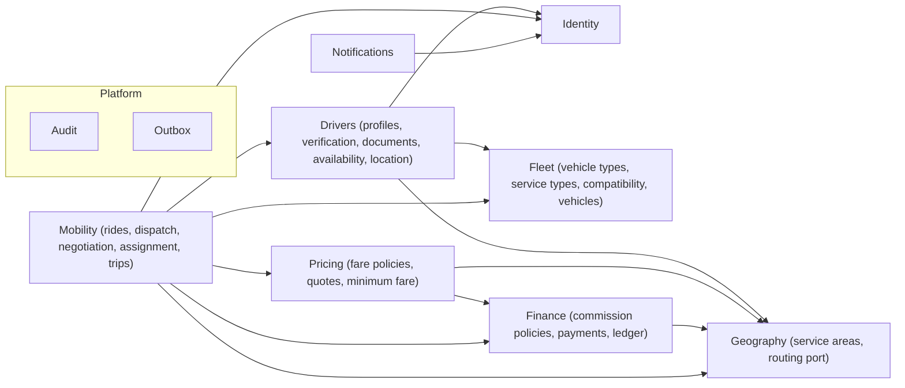

# TAKE-TUK — Domain model

This document describes the business concepts, their relationships and the rules that govern them. Lifecycles are in [STATE_MACHINES.md](STATE_MACHINES.md). Physical tables are in [DATABASE_DESIGN.md](../architecture/DATABASE_DESIGN.md), which, together with the migrations, is authoritative for column-level detail.

Legend: **[Impl]** implemented and tested, **[Partial]** partially implemented, **[Model]** modelled in documentation only, **[P]** planned.

## 1. Bounded contexts (backend modules)

Every module may also use the platform modules `Audit`, `Outbox` and `Idempotency`, and the shared authorization vocabulary. These dependency rules are enforced by an automated architecture test (`backend/test/architecture/architecture.spec.ts`).

## 2. Identity

### User [Impl]
A person who has authenticated with Supabase Auth and registered with TAKE-TUK.

- `id` equals the Supabase Auth user id (the JWT `sub` claim). TAKE-TUK never creates identities itself.
- `display_name`, and `phone_e164` copied from the verified token's `phone` claim when present.
- `status`: `active` | `disabled`. A disabled user is rejected on every authenticated request.
- A user is created only by an explicit registration call (passenger or driver registration), never implicitly. An authenticated but unregistered token can only call `GET /v1/me` and the registration endpoints.

### Role and permission [Impl]
- Roles: `passenger`, `driver`, `admin`. A user may hold several roles.
- `passenger` is granted by passenger registration and `driver` by driver registration. `admin` is granted only by an operator through the CLI (`npm run cli -- grant-role`), and that grant is audited.
- Roles map to fine-grained **permissions** in code (`identity/domain/permissions.ts`). Endpoints declare permissions, never roles.
- Holding a permission is necessary but not sufficient. Use cases also check resource ownership and business state, for example "the driver is approved" or "the ride is assigned to this driver".

## 3. Geography

### Service area [Impl]
A geographic region where TAKE-TUK operates (initially Wad Madani).

- `code`, `display_name`, `timezone`, `boundary` (PostGIS `geography(MultiPolygon, 4326)`), `status` (`active` | `inactive`).
- Each service area enables a set of service types (`service_area_services`). That lets a future city offer different services without code changes.
- Rule: the pickup and the destination of a ride must both lie inside the same active service area that offers the requested service (provisional, PRC-7).

### Coordinates
WGS84 latitude/longitude pairs validated at the API boundary (lat ∈ [-90, 90], lng ∈ [-180, 180]). They are stored as `geography(Point, 4326)`.

### Route estimate [Impl]
The routing provider's answer for an origin–destination pair: `distance_meters`, `duration_seconds`, `provider`, and `estimated_at`. It is produced behind the `RoutingProvider` port (`geography/routing`). Route estimates are stored as **calculation inputs** on the quote, ride and fare agreement, never as raw provider responses (see MAP-2).

Two operations must never be confused:
- **Nearby-driver discovery** is a PostGIS query on our own driver positions. It never calls the routing provider.
- **Route-distance estimation** calls the routing provider, once per quote.

## 4. Fleet

### Vehicle type [Impl]
`raksha`, `pickup`, `motorcycle`. Attributes: `display_name`, `passenger_capable`.

### Service type [Impl]
`passenger_transport`, `food_delivery`, `package_delivery`, `goods_transport`. Attribute: `requires_passenger_capable_vehicle`.

### Service–vehicle compatibility [Impl]
The set of (service type, vehicle type) pairs that may be assigned. The database rejects any pair where the service requires a passenger-capable vehicle and the vehicle type is not one. A motorcycle–passenger pair therefore cannot exist, even through direct SQL. This is the smallest model that meets the requirements. When jobs need finer capability rules (load size, weight, refrigeration), the extension path is per-job capability requirements matched against per-vehicle attributes. That is not built.

### Vehicle [Impl]
A physical vehicle registered by a driver.

- `vehicle_type_code`, `plate_number` (normalised upper case), `description` (make/model/colour, free text), `status`.
- A vehicle belongs to exactly one driver (DRV-3).
- Only an `approved` vehicle can be set as a driver's active vehicle.

## 5. Drivers

### Driver [Impl]
The driver role of a user. Its key is the user id.

- `service_area_id`: the area where the driver operates.
- `full_legal_name`, `driving_license_number`.
- `status`: verification and approval lifecycle (see state machines).
- `availability`: `offline` | `online`. Going online requires `status = approved` and an approved **active vehicle** that the driver owns. The database enforces both.
- Review fields: `submitted_at`, `reviewed_at`, `reviewed_by`, `review_note`.

### Driver document [Impl]
Metadata for a verification document stored in the private Supabase Storage bucket `driver-documents`.

- Types: `driver_photo`, `driving_license`, `national_id`, `vehicle_registration`, `vehicle_photo`. The vehicle types must reference one of the driver's vehicles.
- Upload flow: the driver requests an upload slot, receives a short-lived signed upload URL, uploads directly to storage, then confirms. The backend checks that the object exists before marking it `uploaded`. Re-uploading a type supersedes the previous document.
- Only the owning driver (metadata only) and admins (through short-lived signed download URLs, audited) can access documents.

### Driver location [Impl]
The latest known position of a driver: `location`, `accuracy_meters`, `device_recorded_at`, and `received_at` (server clock). Only the latest position is kept. Matching uses `received_at` for freshness, because device clocks are not trusted. A location update is accepted only from an approved driver. Continuous high-frequency streaming is [P].

## 6. Pricing

### Fare policy [Impl]
A versioned, immutable rule for computing the **minimum permitted fare** for one (service area, service type) scope.

- Parameters (integer minor units): `base_fare_minor`, `per_km_fare_minor`, `minimum_fare_minor` (floor), `rounding_increment_minor`; plus `currency`.
- Formula: `minimum = roundUp(max(floor, base + ceil(per_km × distance_m / 1000)), increment)`. All arithmetic is integer (`pricing/domain/minimum-fare.ts`).
- At most one `active` policy per scope (database constraint). Activating a new version retires the previous one in the same transaction.
- Calculation parameters cannot change after a policy leaves `draft` (database trigger). Every computed fare can be explained by the policy id and version plus the stored inputs.
- No real-world price exists anywhere in code or migrations. Development values live only in `supabase/seed.sql` and are labelled as such.

### Fare quote [Impl]
The backend-computed basis for a ride request. It belongs to one passenger, is valid for a limited time (default 10 minutes) and can be used once.

- Stores pickup, destination, service area and service type, the route estimate (distance, duration, provider, time), the fare-policy id and version, the minimum fare and the currency.
- A ride is created from a quote, so the client never supplies the distance or the minimum fare.
- If the routing provider fails, no quote is created and the API returns `503 ROUTING_UNAVAILABLE`. The backend **never** substitutes straight-line distance or invents a fare.

### Fare values: never interchangeable

| Value | Where it lives | Set by |
|---|---|---|
| Estimated route distance | `fare_quotes.route_distance_meters` (copied to ride and agreement) | Routing provider |
| Minimum permitted fare | `fare_quotes.minimum_fare_minor` (copied to ride, offers and agreement) | Fare policy |
| Passenger proposed fare | `rides.proposed_fare_minor` | Passenger, ≥ minimum (database check) |
| Driver counteroffer | `ride_offers.counter_fare_minor` | Driver, ≥ minimum and > proposal (database check on minimum) |
| Final agreed fare | `fare_agreements.agreed_fare_minor`, `rides.agreed_fare_minor` | Result of the acceptance rules |
| Actual amount collected | `ride_payments.amount_collected_minor` | Driver report (cash) |
| Platform commission | `ledger_entries` for the `ride_commission` transaction; rate on `ride_assignments` | Commission policy |

## 7. Mobility

### Ride [Impl]
A passenger's request for transport and, once assigned, the trip itself. One aggregate covers both phases, with two state machines (see STATE_MACHINES §1–§4).

- Created from one quote (`quote_id` unique). It copies the quote's immutable pricing inputs.
- `proposed_fare_minor` ≥ `minimum_fare_minor` (database check).
- Search window `search_expires_at`. Dispatch bookkeeping: `dispatch_round`, `next_dispatch_at`.
- When assigned: `assigned_driver_id`, `assigned_vehicle_id`, `fare_agreement_id`, `agreed_fare_minor`. A database check requires all of them in every post-assignment status.
- Cancellation facts: `cancelled_by_role`, `cancelled_by_user_id`, `cancellation_reason`, `cancelled_at`, and the status the ride was in when it was cancelled.
- A passenger has at most one open ride (database partial unique index).

### Ride offer (dispatch offer and fare negotiation) [Impl]
An invitation to one driver to serve one ride, plus that driver's negotiation.

- Snapshots the proposal (`offered_fare_minor`) and the minimum fare.
- The driver can accept, decline or counteroffer. A counteroffer is accepted or rejected by the passenger.
- `expires_at` bounds the current response window (the driver's, then the passenger's after a counteroffer).
- A ride is offered to a driver at most once. A driver holds at most one open offer at a time. Both are database constraints.

### Fare agreement [Impl]
An immutable record that the passenger and one driver agreed on a fare.

- `basis`: `driver_accepted_passenger_proposal` | `passenger_accepted_driver_counteroffer`.
- Stores the agreed amount, the proposal, the counteroffer, the minimum fare, the fare-policy id and version, the route distance and provider, the quote id and the time.
- One agreement per ride (unique). Append-only: the backend database role has no UPDATE or DELETE privilege on it.

### Ride assignment [Impl]
The driver's job record: ride, driver, vehicle, fare agreement, and the commission policy and rate in force when the job was accepted.

- At most one `active` assignment per ride and one `active` assignment per driver (partial unique indexes). Together with the ride row lock and status-conditional update, these are the core concurrency guarantees.

### Dispatch (driver matching) [Impl]
A policy-driven selection of candidates for a ride (ADR-0012). It runs in rounds until a fare is agreed or the search window ends. Candidate rules:

1. Driver `status = approved` and `availability = online`.
2. The active vehicle is `approved` and its type is compatible with the ride's service type.
3. The driver operates in the ride's service area.
4. The latest position was received within the freshness window and lies within the dispatch radius of the pickup (PostGIS `ST_DWithin` on `geography`).
5. The driver has no active assignment and no open offer.
6. The driver has not already been offered this ride.
7. The driver is not the passenger.
8. Ordered by distance to pickup and limited to the batch size.

The nearest driver is not assumed to be the best. Distance ordering is only the initial, explainable policy.

## 8. Finance

### Commission policy [Impl]
A versioned, immutable `rate_basis_points` (0–10000) per (service area, service type), with the same draft → active → retired lifecycle as fare policies.

### Ride payment [Impl]
The record of what the passenger owes the driver for a completed ride, and what was reported collected.

- `method = cash` (v1). `amount_due_minor` equals the agreed fare.
- `amount_collected_minor` is reported by the driver. A record of an obligation is **not** evidence of collection.
- One per ride (unique).

### Ledger [Impl]
Double-entry, append-only records of the **platform's** financial positions.

- `ledger_transactions` group balanced `ledger_entries`. A deferred constraint trigger checks that the entries of each transaction sum to zero per currency.
- v1 accounts: `driver_commission_receivable` (per driver; positive = driver owes the platform) and `platform_commission_revenue`.
- On completion, one `ride_commission` transaction per ride (unique on kind and ride) debits the driver's receivable and credits revenue.
- No mutable balance field exists. Balances are sums over entries.
- The cash fare paid by the passenger to the driver is not money the platform holds, so it does not appear in the platform ledger. It is recorded in `ride_payments` for reconciliation.
- [P]: settlements, refunds, penalties, reversals and digital-payment clearing accounts. Adding them means new account types and transaction kinds, without changing the model.

### Driver earnings [Impl]
A derived view per driver: completed rides with agreed fare, reported collection and commission, plus the total commission owed (receivable balance).

## 9. Platform

### Audit event [Impl]
Append-only record of important actions: actor (user id and role, or system), action, entity type and id, request id, timestamp, and non-sensitive metadata. Written in the **same transaction** as the change it describes.

### Outbox event [Impl]
A durable record of a domain event that must eventually be published (notifications). Written in the same transaction as the state change, and delivered by a worker with retries, backoff and a maximum attempt count. Notifications are never the source of truth.

### Device registration [Impl]
A push token for one user and app (`passenger` | `driver`) and platform (`android` | `ios`).

### Idempotency record [Impl]
Stores the request fingerprint and response for an (`user`, `operation`, `Idempotency-Key`) triple for 24 hours, so a retried request replays the original response.

## 10. Marketplace, orders and delivery [Model]

These are modelled now so that later phases fit cleanly. None is implemented.

- **Merchant**: a business (`pending_review` → `approved` | `rejected`; `approved` ↔ `suspended`) with **branches** (location, opening hours) and staff users (`merchant_owner`, `merchant_staff` roles).
- **Catalog**: products per branch with availability and images in a public-read storage bucket.
- **Merchant order**: a customer's order to one branch (state machine in STATE_MACHINES §8).
- **Delivery job**: the movement of goods from A to B, for food orders, packages or goods transport. It is a separate aggregate from a ride and is linked to an order when one exists. It uses the same dispatch and compatibility machinery with a different service type (STATE_MACHINES §9).

The key distinctions:

| Concept | What it is | Who is moved | Linked to |
|---|---|---|---|
| Vehicle | A physical vehicle with a type | — | Driver |
| Service type | A kind of work the platform sells | — | Compatible vehicle types |
| Ride | Passenger transport request and trip | Passenger | Quote, offers, agreement, assignment, payment |
| Merchant order | A purchase from a merchant | — | Merchant branch, customer, delivery job |
| Delivery job | Moving goods from A to B | Goods | Optional order; driver assignment |
