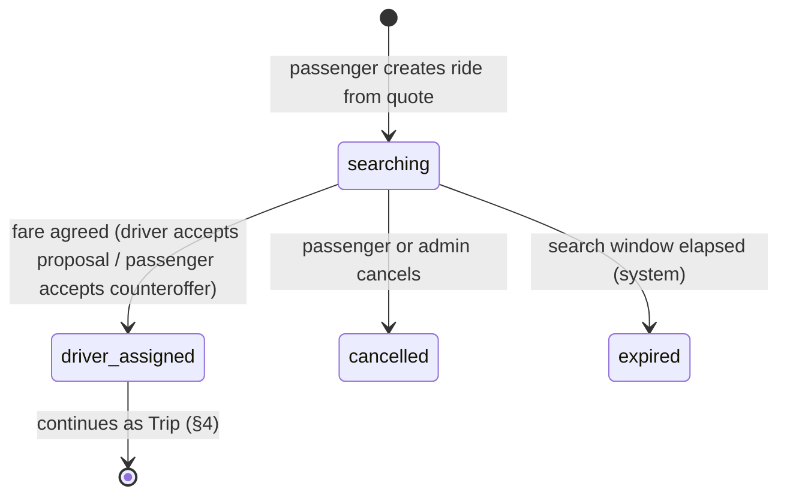
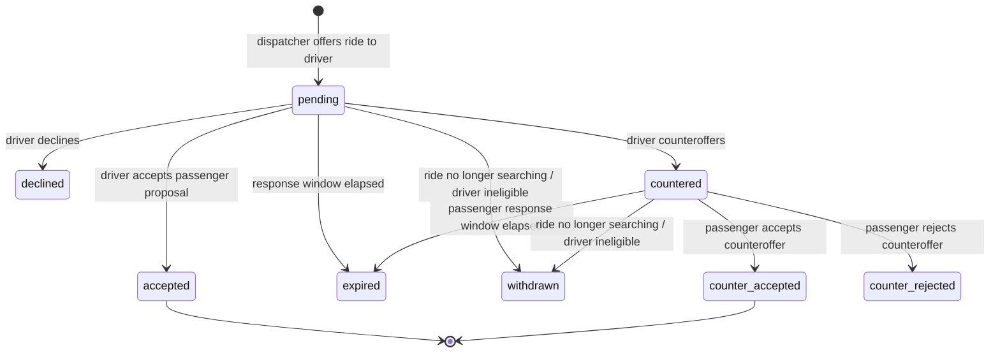
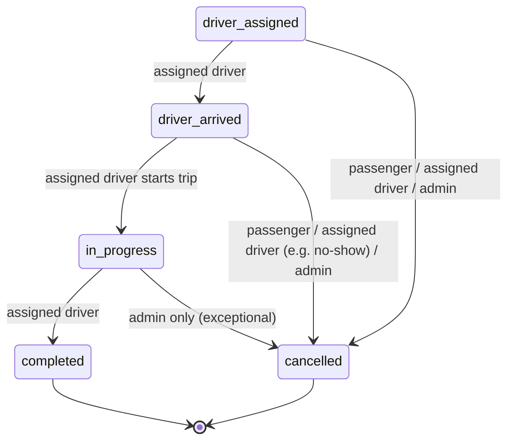
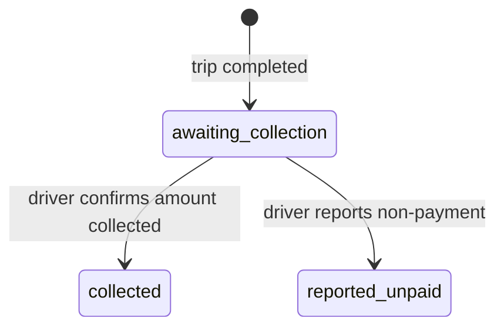
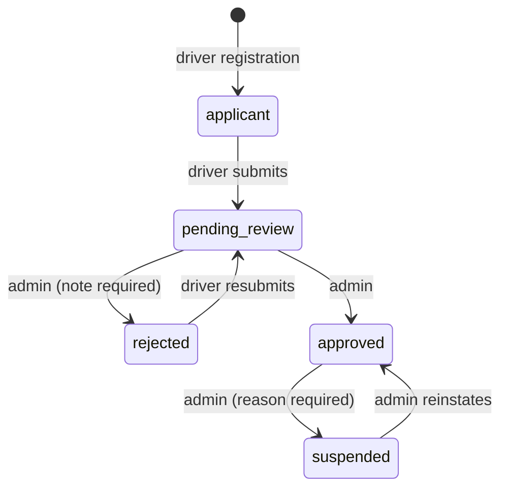
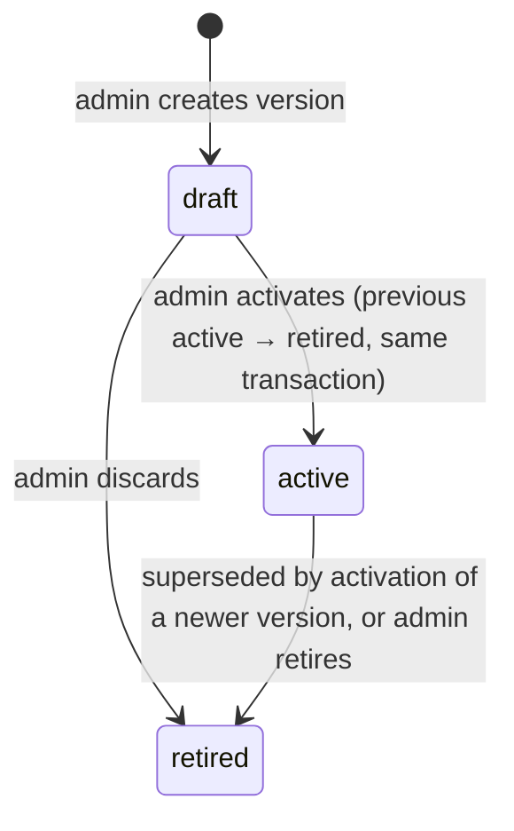
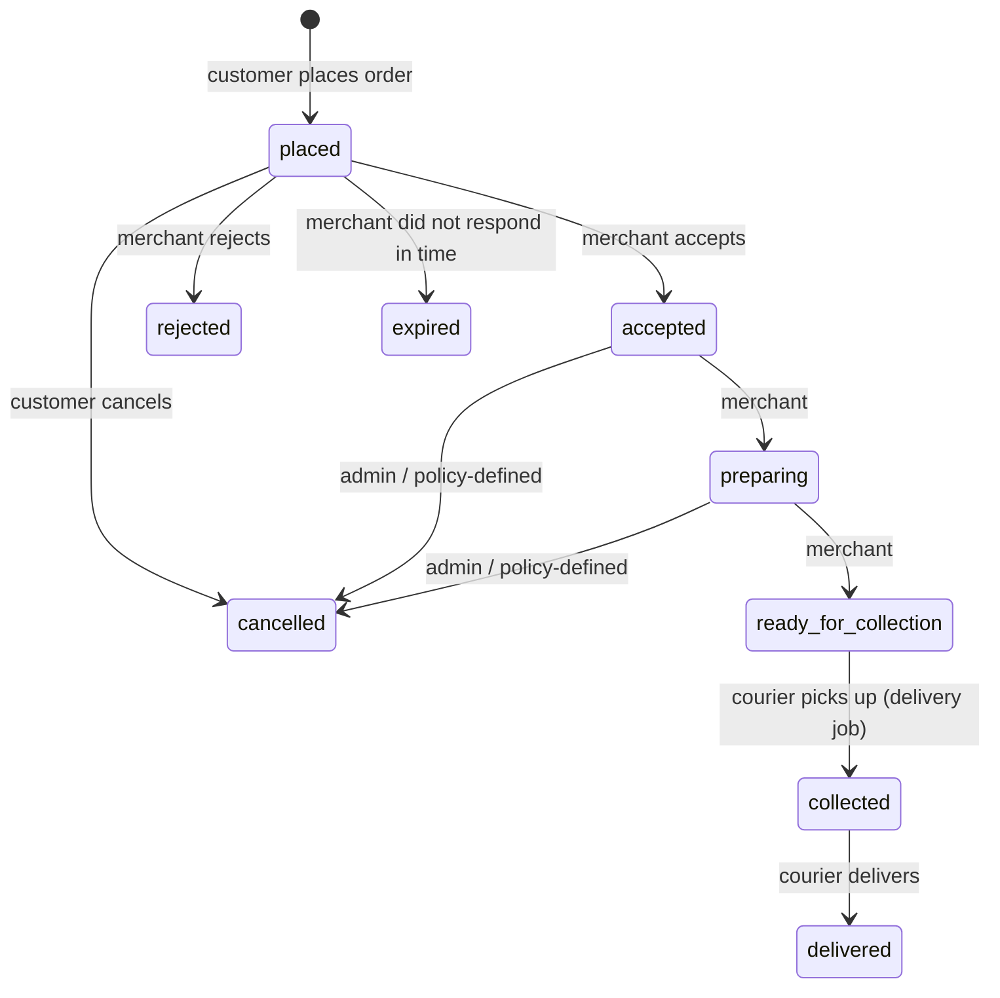
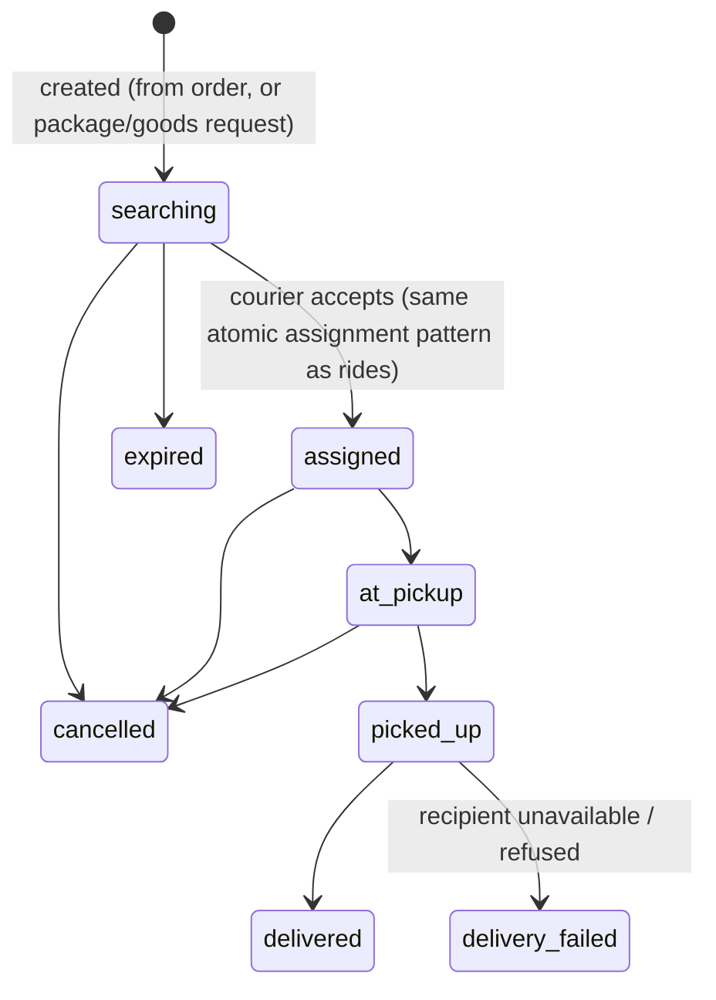

# TAKE-TUK — State machines and business invariants

Every critical entity has an explicit lifecycle, and transitions happen only through named application use cases. A request from a client is never trusted to set a status. The use case decides whether the transition is legal for **this actor**, given **this state**.

Each lifecycle is enforced at three levels:

1. **Domain**: transition tables in code (`backend/src/modules/*/domain/*-state-machine.ts`) define the legal transitions and the actors allowed to perform them. Unit tests cover every pair.
2. **Application**: use cases lock the aggregate (`SELECT … FOR UPDATE`) or use status-conditional updates, check preconditions inside the transaction, and write state, audit event and outbox event atomically.
3. **Database**: a trigger (`taketuk.enforce_status_transition`) rejects any `status` change that is not listed in `taketuk.status_transitions`. That table is seeded by migrations. An integration test asserts that it matches the code transition tables exactly. A bug, or a manual SQL session using the backend role, cannot create an illegal transition.

Status values: **[Impl]** implemented and tested, **[Model]** specified only.

Error codes named below are the stable `code` values of the API problem responses ([API_CONVENTIONS](../api/API_CONVENTIONS.md)).

---

## 1. Ride request [Impl]

The pre-assignment phase of a `ride`. Statuses: `searching` → (`driver_assigned` | `cancelled` | `expired`).

| Transition | Actor | Preconditions (checked inside the transaction) | Side effects (same transaction) | Audit action | Failure codes |
|---|---|---|---|---|---|
| (new) → `searching` | Passenger (owner of quote) | Registered user with the `passenger` role. The quote belongs to the caller, is unexpired and unconsumed. `proposed_fare ≥ quote.minimum_fare` and the currency matches. The caller has no other open ride. `Idempotency-Key` header present. | Quote marked consumed. Ride inserted with `search_expires_at = now + RIDE_SEARCH_TIMEOUT`. Idempotency record stored. Outbox `ride.requested`. | `ride.requested` | `QUOTE_NOT_FOUND`, `QUOTE_EXPIRED`, `QUOTE_ALREADY_USED`, `FARE_BELOW_MINIMUM`, `CURRENCY_MISMATCH`, `RIDE_ALREADY_OPEN`, `IDEMPOTENCY_KEY_REQUIRED`, `IDEMPOTENCY_KEY_REUSED` |
| `searching` → `driver_assigned` | System, triggered by the driver (accept) or the passenger (accept counteroffer) | See §3 (assignment). | See §3. | `ride.assigned` | See §2 and §3 |
| `searching` → `cancelled` | Passenger (owner) or admin | Ride is `searching`. | All open offers → `withdrawn`. Cancellation facts recorded. Outbox `ride.cancelled`. | `ride.cancelled` | `RIDE_NOT_FOUND`, `INVALID_STATE_TRANSITION` |
| `searching` → `expired` | System (dispatch sweeper) | `search_expires_at ≤ now()`. | Open offers → `withdrawn`. Outbox `ride.expired`. | `ride.expired` | — |

**Dispatch while searching.** After the ride is created (in a separate transaction, so a dispatch failure cannot undo ride creation) and on every sweeper tick, a dispatch round runs if the ride is `searching`, has no open offers, and `next_dispatch_at ≤ now()`. A round locks the ride row (`FOR UPDATE SKIP LOCKED` in the sweeper), selects candidates (DOMAIN_MODEL §7), and inserts offers. When no candidate exists, `next_dispatch_at` moves forward by `DISPATCH_RETRY_INTERVAL`. Each round increments `dispatch_round`.

**Retry behaviour.** Ride creation is idempotent per (`user`, `Idempotency-Key`): a retry with the same body replays the original 201 response, and the same key with a different body returns `422 IDEMPOTENCY_KEY_REUSED`. Cancel is naturally idempotent for the same actor: cancelling an already-cancelled ride returns the current representation with `200`.

---

## 2. Fare negotiation: ride offer [Impl]

Open states: `pending`, `countered`. Every other state is terminal.

| Transition | Actor | Preconditions | Side effects | Audit action | Failure codes |
|---|---|---|---|---|---|
| (new) → `pending` | System (dispatch) | Candidate rules (DOMAIN_MODEL §7). No open offer for the driver and no prior offer for this ride and driver (database-unique). | `expires_at = least(now + OFFER_RESPONSE_TIMEOUT, ride.search_expires_at)`. Snapshots `offered_fare_minor` and `minimum_fare_minor`. Outbox `ride.offer_created`. | `ride_offer.created` | Unique conflicts are skipped silently (another round won the driver) |
| `pending` → `accepted` | The offered driver | Offer open and `expires_at > now()`. Ride `searching`. Driver approved and online. The driver's active vehicle is the offered vehicle, approved, and compatible. The driver has no active assignment. | **Assignment** (§3) with basis `driver_accepted_passenger_proposal`. | `ride_offer.accepted` | `OFFER_NOT_FOUND`, `OFFER_EXPIRED`, `OFFER_NOT_OPEN`, `RIDE_NO_LONGER_AVAILABLE`, `DRIVER_NOT_APPROVED`, `DRIVER_NOT_AVAILABLE`, `DRIVER_BUSY`, `VEHICLE_NOT_ELIGIBLE` |
| `pending` → `declined` | The offered driver | Offer `pending`. | Driver becomes free for other offers. | `ride_offer.declined` | `OFFER_NOT_FOUND`, `OFFER_NOT_OPEN` |
| `pending` → `countered` | The offered driver | As for accept, plus `counter ≥ minimum_fare` (also a database check), `counter > offered_fare` (PRC-3), and the currency matches. | `counter_fare_minor` set. `expires_at = least(now + COUNTEROFFER_RESPONSE_TIMEOUT, ride.search_expires_at)`. Outbox `ride.counteroffer_received`. | `ride_offer.countered` | as for accept, plus `FARE_BELOW_MINIMUM`, `COUNTEROFFER_NOT_ABOVE_PROPOSAL` |
| `countered` → `counter_accepted` | The passenger who owns the ride | Offer `countered` and `expires_at > now()`. Ride `searching`. The offered driver is still eligible (approved, online, same approved and compatible vehicle, no active assignment). | **Assignment** (§3) with basis `passenger_accepted_driver_counteroffer` at `counter_fare_minor`. | `ride_offer.counter_accepted` | `OFFER_NOT_FOUND`, `OFFER_EXPIRED`, `OFFER_NOT_OPEN`, `RIDE_NO_LONGER_AVAILABLE`, `DRIVER_NOT_AVAILABLE`, `DRIVER_BUSY` |
| `countered` → `counter_rejected` | The passenger who owns the ride | Offer `countered`. | Driver free. Outbox `ride.counteroffer_rejected`. | `ride_offer.counter_rejected` | `OFFER_NOT_FOUND`, `OFFER_NOT_OPEN` |
| open → `expired` | System (sweeper) | `expires_at ≤ now()`. | — | — (high volume; reconstructable from timestamps) | — |
| open → `withdrawn` | System | The ride left `searching` (assigned elsewhere, cancelled or expired), or the driver is no longer eligible (offline, suspended, vehicle changed). | — | — | — |

**Expiry is enforced at decision time.** Every use case compares `expires_at` with the database clock (`now()`), so an offer past its window can never be accepted, even before the sweeper has marked it `expired`.

**Retry behaviour.** Accepting an offer that the same driver already accepted, or accepting a counteroffer the same passenger already accepted, returns the existing assignment (`200`) and creates nothing new. Decline and reject return `409 OFFER_NOT_OPEN` if the offer is already terminal.

---

## 3. Driver assignment [Impl]

Statuses: `active` → (`completed` | `cancelled`).

**Assignment use case: the critical section.** It runs in one READ COMMITTED transaction:

1. `SELECT … FROM rides WHERE id = $1 FOR UPDATE`. Competing acceptances for the same ride now run one at a time.
2. Lock the offer row (`FOR UPDATE`) and check it is open, unexpired and in the expected state.
3. Check that the ride is `searching`. If it is already assigned to this driver through this offer, return the existing assignment (idempotent retry). Otherwise return `409 RIDE_NO_LONGER_AVAILABLE`.
4. Lock the driver row (`FOR UPDATE`) and re-check eligibility (approved, online, same active vehicle, vehicle approved and compatible).
5. Load the active commission policy for the ride's scope (`PRICING_NOT_CONFIGURED` if none).
6. Insert the `fare_agreement` (unique per ride and per offer).
7. Insert the `ride_assignment` with status `active`. Unique per ride and per driver among active assignments: a unique violation becomes `409 DRIVER_BUSY` or `409 RIDE_NO_LONGER_AVAILABLE`.
8. Update the ride `searching → driver_assigned`, conditioned on `status = 'searching'`, and set the driver, vehicle, agreement and agreed fare.
9. Update the offer to `accepted` or `counter_accepted`. All other open offers for the ride → `withdrawn`.
10. Insert the audit events and outbox `ride.assigned` (notifies passenger and driver).

Lock order is always **ride → offer → driver**. Every use case that locks more than one of these follows that order, which prevents deadlocks. Serialization failures and deadlocks (SQLSTATE `40001`/`40P01`) are retried up to 3 times by the transaction helper. No external call ever happens inside a transaction.

Four independent safeguards ensure at most one confirmed driver per ride:

- the ride row lock with a status check,
- a status-conditional update,
- `UNIQUE (ride_id)` on `fare_agreements`,
- a partial unique index on active assignments per ride.

The partial unique index on active assignments per driver ensures that no driver can hold two jobs at once.

| Transition | Actor | Trigger | Side effects |
|---|---|---|---|
| (new) → `active` | System | Ride `searching → driver_assigned` | — |
| `active` → `completed` | System | Ride `in_progress → completed` | — |
| `active` → `cancelled` | System | Ride cancelled after assignment | — |

---

## 4. Trip [Impl]

The post-assignment phase of a `ride`.

| Transition | Actor | Preconditions | Side effects | Audit action |
|---|---|---|---|---|
| `driver_assigned` → `driver_arrived` | Assigned driver | Active assignment belongs to caller | `driver_arrived_at`. Outbox `ride.driver_arrived`. | `ride.driver_arrived` |
| `driver_arrived` → `in_progress` | Assigned driver | same | `started_at`. Outbox `ride.started`. | `ride.started` |
| `in_progress` → `completed` | Assigned driver | same | `completed_at`. Assignment → `completed`. **Finance**: `ride_payment` (`awaiting_collection`, `amount_due = agreed_fare`) and a `ride_commission` ledger transaction (commission = `round_half_up(agreed_fare × rate_bp / 10000)`; FIN-2). Outbox `ride.completed`. | `ride.completed`, `finance.ride_commission_charged` |
| `driver_assigned` \| `driver_arrived` → `cancelled` | Passenger (owner), assigned driver, admin | — | Assignment → `cancelled`. Cancellation facts include the status at cancellation. No penalty is applied (FIN-4). Outbox `ride.cancelled`. | `ride.cancelled` |
| `in_progress` → `cancelled` | Admin only | Reason required | Assignment → `cancelled`. No payment record. | `ride.cancelled` |

A passenger can never mark a trip arrived, started or completed. Passengers lack the permission, and the use case also requires the caller to be the assigned driver. A driver who is not the assigned driver receives `404 RIDE_NOT_FOUND`, so the ride's existence is not revealed.

**Retry behaviour.** Each driver transition is naturally idempotent: repeating a transition the ride is already in (for example, complete on a `completed` ride, by the same driver) returns the current representation with `200` and produces no second payment or ledger transaction. This is guaranteed by `UNIQUE (ride_id)` on `ride_payments` and `UNIQUE (kind, ride_id)` on `ledger_transactions`.

---

## 5. Ride payment (cash) [Impl]

| Transition | Actor | Preconditions | Side effects | Audit action |
|---|---|---|---|---|
| (new) → `awaiting_collection` | System | Ride completed | — | (part of `ride.completed`) |
| `awaiting_collection` → `collected` | Assigned driver | `amount_collected ≥ 1` minor unit and the currency matches | `amount_collected_minor` and `reported_at` recorded. A discrepancy against `amount_due` is visible in the record. | `finance.cash_collection_reported` |
| `awaiting_collection` → `reported_unpaid` | Assigned driver | — | `reported_at` | `finance.cash_non_payment_reported` |
| [Model] `collected` \| `reported_unpaid` → `disputed` → `resolved` | Passenger, driver, admin | — | Reversal or adjustment ledger transactions | — |

**Retry behaviour.** Reporting the same outcome with the same amount again returns `200` with the current record. A different outcome or amount returns `409 PAYMENT_ALREADY_REPORTED`.

---

## 6. Driver verification [Impl]

| Transition | Actor | Preconditions | Side effects | Audit action |
|---|---|---|---|---|
| (new) → `applicant` | User | Not already a driver. The service area is active. | `driver` role granted | `driver.registered` |
| `applicant` \| `rejected` → `pending_review` | The driver | Required documents uploaded (DRV-1). At least one vehicle that is not rejected, with its required documents. | `submitted_at` | `driver.submitted_for_review` |
| `pending_review` → `approved` | Admin (`driver:review`) | — | `reviewed_at`, `reviewed_by` | `driver.approved` |
| `pending_review` → `rejected` | Admin (`driver:review`) | `note` provided | review fields | `driver.rejected` |
| `approved` → `suspended` | Admin (`driver:suspend`) | `reason` provided | `availability = offline` in the same update. Open offers are withdrawn by the sweeper. An active trip is not cancelled automatically: the admin may cancel it explicitly. | `driver.suspended` |
| `suspended` → `approved` | Admin (`driver:suspend`) | — | — | `driver.reinstated` |

Profile fields can be edited only in `applicant` or `rejected` (`409 PROFILE_NOT_EDITABLE` otherwise). An admin can never approve their own driver profile (`403 SELF_REVIEW_FORBIDDEN`).

### Driver availability [Impl]

`offline` ↔ `online`. Going online requires `status = approved` and an `approved` vehicle owned by the driver. The database enforces this with a CHECK (online ⇒ approved and active vehicle set) and a composite foreign key (active vehicle ⇒ owned). Going offline is always permitted, including during a trip (DRV-4); it only stops new offers. Audit: `driver.went_online`, `driver.went_offline`.

### Vehicle review [Impl]

`pending_review` → `approved` | `rejected` (admin, `vehicle:review`), `approved` → `suspended` → `approved` (admin). Suspending a driver's active vehicle sets that driver offline in the same transaction. Audit: `vehicle.registered`, `vehicle.approved`, `vehicle.rejected`, `vehicle.suspended`, `vehicle.reinstated`.

### Driver document [Impl]

`upload_pending` → `uploaded` (the driver confirms; the object must exist in storage). `uploaded` → `superseded` (system, when a newer document of the same type and vehicle is confirmed). Audit: `driver_document.uploaded`, `driver_document.viewed` (admin signed-URL issuance).

---

## 7. Fare policy and commission policy [Impl]

- Calculation fields are immutable once a policy leaves `draft` (database trigger).
- At most one `active` policy per (service area, service type) (partial unique index).
- Retiring the only active policy stops new quotes (`PRICING_NOT_CONFIGURED`). Existing quotes and rides keep their snapshot.
- Audit: `fare_policy.created`, `fare_policy.activated`, `fare_policy.retired` (and the same for `commission_policy.*`).

---

## 8. Merchant order [Model]

Open design points: payment timing (on order or on delivery), the merchant acceptance timeout, and refund rules. These are decided when the marketplace phase starts.

## 9. Delivery job [Model]

A delivery job reuses the dispatch, compatibility and assignment machinery with service types `food_delivery`, `package_delivery` and `goods_transport`. It does not reuse the `rides` table.

## 10. Dispute [Model]

`opened` (passenger, driver or admin) → `under_review` (admin) → `resolved` (outcome: `no_action` | `commission_reversed` | `refund_issued` | `penalty_applied`) | `dismissed`. Each financial outcome is a new balanced ledger transaction, never an edit of an existing one.

## 11. Outbox event [Impl]

`pending` → `published` | `failed`. Delivery attempts increment `attempts`. A failed attempt reschedules `available_at` with exponential backoff (base 2 s, capped at 5 minutes). After `OUTBOX_MAX_ATTEMPTS` the event becomes `failed`, is logged at error level, and waits for operator action (requeue is [P]). A worker claims events by setting `claimed_until` in a short transaction. It delivers outside any transaction and records the result in another short transaction. A crashed worker's claim lapses and the event is retried. Handlers must therefore tolerate duplicates (push notifications are at-least-once). The database table does not use the generic status trigger, because it is infrastructure state rather than business state.

## 12. Idempotency record [Impl]

Created in the **same transaction** as the operation it protects, so the stored response exists if and only if the effect was committed. Concurrent duplicates block on the primary key until the first transaction finishes, then replay its response. Records expire after 24 hours (`IDEMPOTENCY_TTL`) and are deleted by the maintenance worker. After expiry the key may be reused.

---

## Business invariants (summary)

| Invariant | Enforced by |
|---|---|
| A ride is confirmed for at most one driver | Ride row lock with status-conditional update; `fare_agreements UNIQUE(ride_id)`; partial unique active assignment per ride |
| A driver has at most one active job | Partial unique active assignment per driver |
| A driver holds at most one open offer | Partial unique index on `ride_offers(driver_id) WHERE status IN ('pending','countered')` |
| No proposal or agreed fare below the minimum | Use-case validation and CHECK constraints on rides, offers and agreements |
| Motorcycles (and pickups) never serve passenger transport | Declarative compatibility constraint (composite FKs and CHECK) and candidate query |
| Only approved drivers with approved, owned vehicles go online | CHECK and composite FK on `drivers` |
| Illegal status changes are impossible | Domain transition tables and the database transition trigger |
| Fare and commission policies used in the past cannot be altered | Immutability trigger, versioning, and snapshots on quotes, rides, agreements and assignments |
| Financial and audit history is append-only | No UPDATE or DELETE privileges for the backend role on agreements, ledger and audit tables |
| Ledger transactions balance | Deferred constraint trigger (sum per currency = 0) |
| One payment record and one commission charge per ride | `UNIQUE` constraints |
